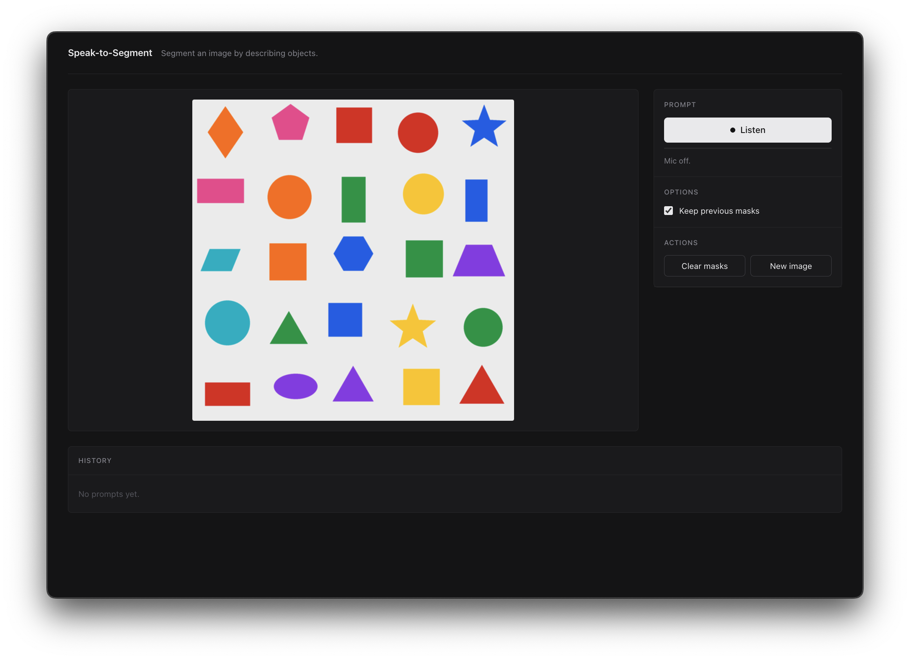
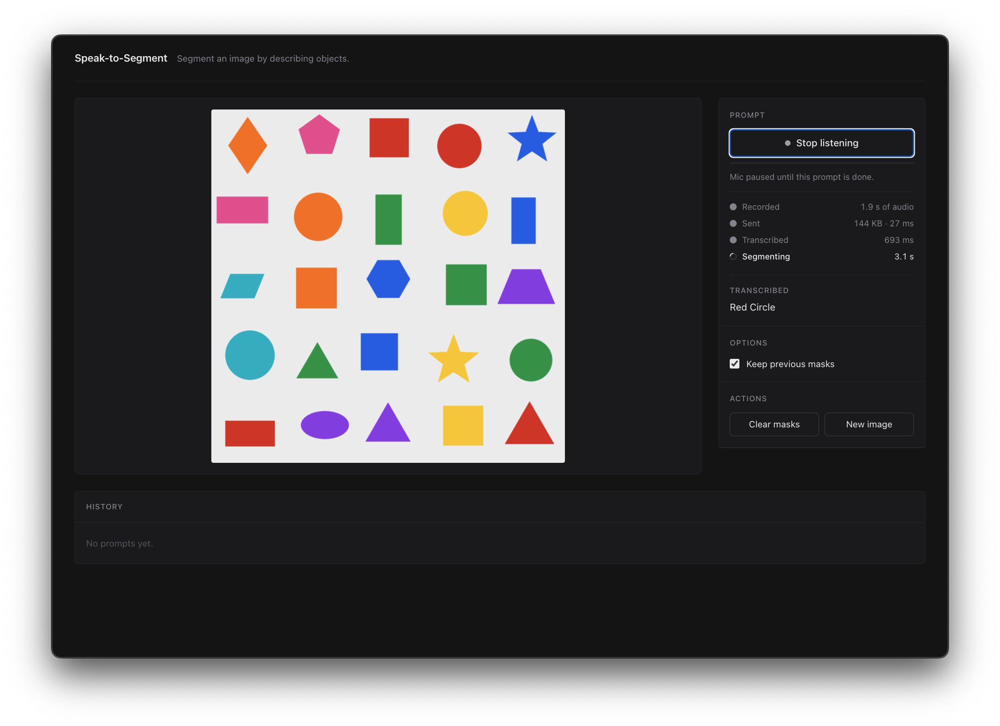
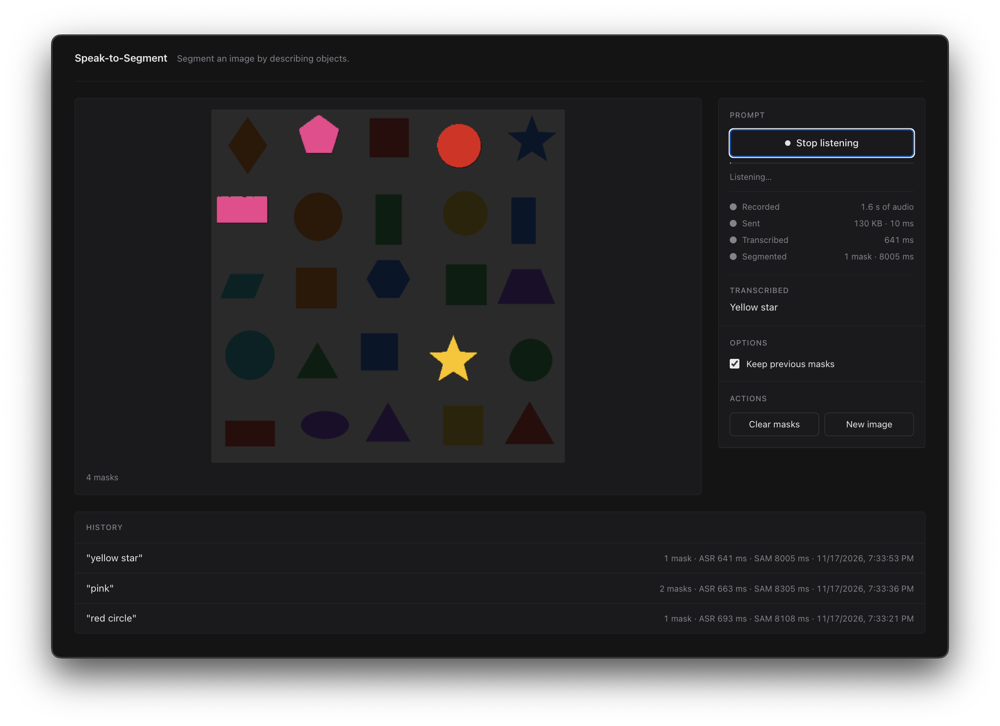
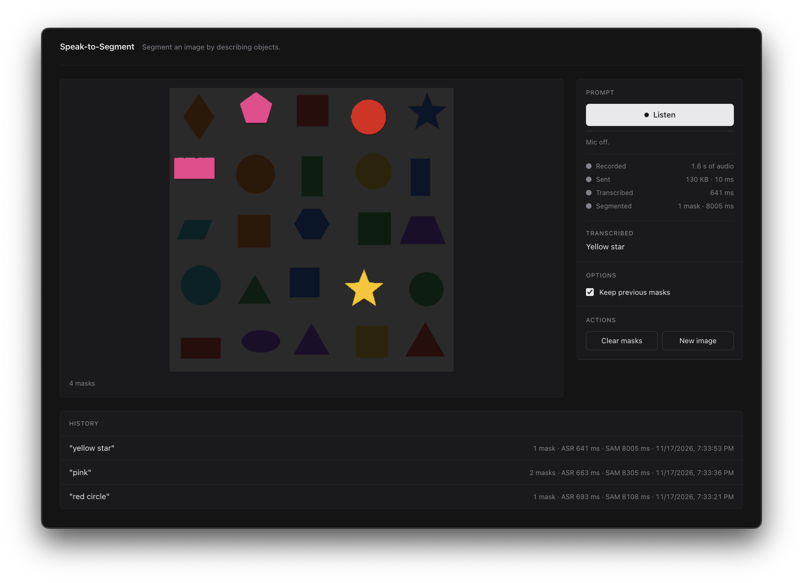

Every version of [SAM](https://github.com/facebookresearch/segment-anything) so far has required you to click. Click a point, drag a box around the thing, click again because the first click grabbed the shadow. It works, but your hands are doing all the prompting, and a lot of the time they’re full.

<figure>
  
  <figcaption style="margin-top: 0.5em;">The promptable segmentation task (<a href="https://arxiv.org/abs/2304.02643">Kirillov et al., 2023</a>).</figcaption>
</figure>

The funny thing is that text was in the picture from the start. The fourth box in the original paper's schematic says "cat with black ears". But the paper treated text as a proof of concept, and the model that actually shipped only took points, boxes and masks.

[SAM 3](https://ai.meta.com/research/sam3/) finally introduced text prompts. You give it a short noun phrase, e.g. "green canary", and it hands back a mask for every green canary in the image. And once the prompt is text, the prompt can be speech, because turning speech into text is a solved-enough problem. So the week SAM 3 came out I glued the two together to see what it felt like.

<figure>
  
  <figcaption style="margin-top: calc(12px - 6.8%);">1. Drop an image on the page.</figcaption>
</figure>

<figure>
  
  <figcaption style="margin-top: calc(12px - 6.8%);">2. Click Listen and say what you want.</figcaption>
</figure>

<figure>
  
  <figcaption style="margin-top: calc(12px - 6.8%);">3. Stop talking: Whisper transcribes, SAM 3 segments.</figcaption>
</figure>

<figure>
  
  <figcaption style="margin-top: calc(12px - 6.8%);">4. Three prompts later: four shapes, each with its latency.</figcaption>
</figure>

<figure>
  
  <figcaption style="margin-top: calc(12px - 6.8%);">5. Stop listening, and the masks stay put.</figcaption>
</figure>

## Masks — hands-free

My prototype is a single web page. You drop an image on it, click `Listen`, and say precisely what you want segmented. A moment after you stop talking, the matching object areas light up and the page shows you what it thought you said.

There are three processes behind it, and none of them is interesting on its own:

- **A Flask app** that serves the page and plays traffic cop.
- **A [Whisper](https://github.com/openai/whisper) endpoint** that takes audio data and returns text.
- **A SAM 3 endpoint** that takes an image plus prompts and returns masks.

Both models sit behind [LitServe](/blog/from-torchserve-to-litserve/), so each one is just a URL in a Hydra config. The browser records the prompt as a short WAV clip, base64-encodes it, and posts it along with the image. The whole pipeline is two HTTP calls in a row:

```python
# step 1: audio -> text
asr_result = requests.post(config.asr.target_address,
                           json={"audio": audio_base64, "lang": "en"}).json()
text_prompt = asr_result.get("text", "")

# step 2: image + text -> masks
sam_result = requests.post(config.sam.target_address,
                           json={"image": image_base64,
                                 "text_prompt": text_prompt}).json()
```

That is the entire idea. The transcript is the prompt, verbatim, with nothing clever in between.

The one decision worth mentioning is how the masks get to the browser. A segmentation mask is an image-sized grid of zeros and ones, and the lazy way to get it to a browser is `mask.tolist()` into JSON. For a modest image size, that is millions of digits and commas per object, and the browser then has to turn them back into pixels.

The page only needs to *draw* the mask, so the server sends an outline instead: run `cv2.findContours` on each mask, keep the largest contour, flatten it to `[x1, y1, x2, y2, ...]`. The browser dims the whole image, then redraws it at full brightness inside each polygon. A few hundred numbers per object instead of a few million.

It is a lossy shortcut, and that should be stated explicitly. Keeping only the largest external contour means a donut comes back as a disc, and an object split in two by something in front of it comes back as its bigger half. For a demo that is fine. For anything that needs to measure area, you would want to return the full segmentation mask.

## A few small improvements

A few things I added because the bare version was annoying to use:

- **Aggregate masks.** By default each new prompt adds to what is already on the canvas, so you can build up a scene one phrase at a time. Untick it and each prompt starts clean.
- **Prompt history.** Every prompt is listed with its transcript, how many masks came back, and the latency split between speech recognition and segmentation. Seeing the two numbers side by side tells you immediately which phase is to blame.
- **Show the transcript.** When nothing lights up, the first question is always whether SAM missed or Whisper misheard. Printing the transcribed prompt answers it before you ask.

## Looking forward

This was a few days of glue, and it shows. You upload a still image; there is no live camera. The confidence threshold is hardcoded low, so a vague prompt gets you generous results. And you *still* have to click (ha!) the `Listen` button to turn the mic on, which rather undercuts the hands-free pitch.

But that one click is the only part of the loop that still needs a hand, and the rest held together better than two models duct-taped over HTTP had any right to. The obvious next step is to lose the button and the JPEG: a wake word, a live camera, and nothing for your hands to do!

Code is available at [dnl-strnl/samcam](https://github.com/dnl-strnl/samcam).
