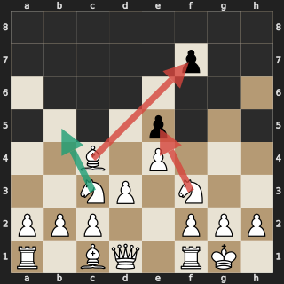
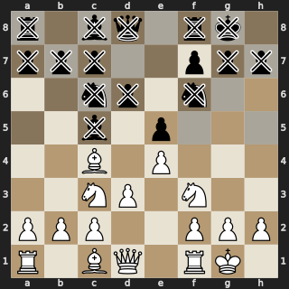
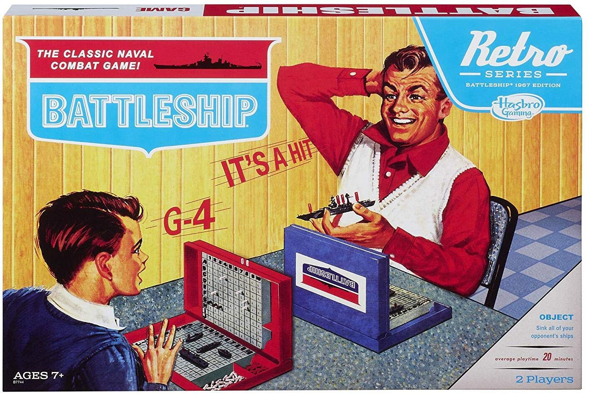
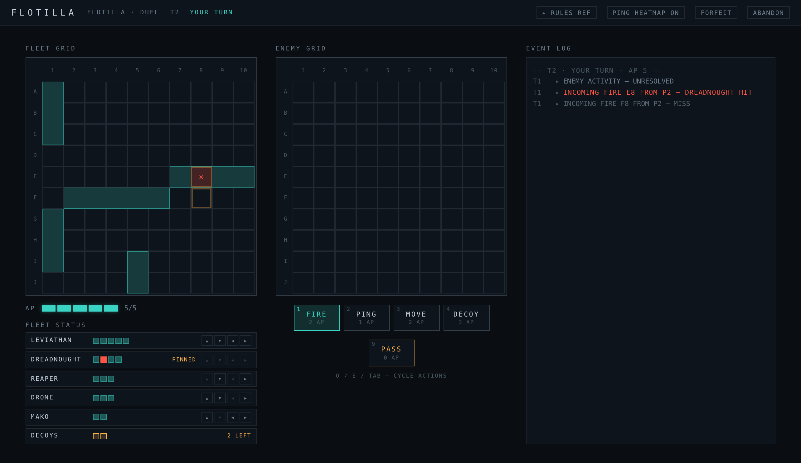
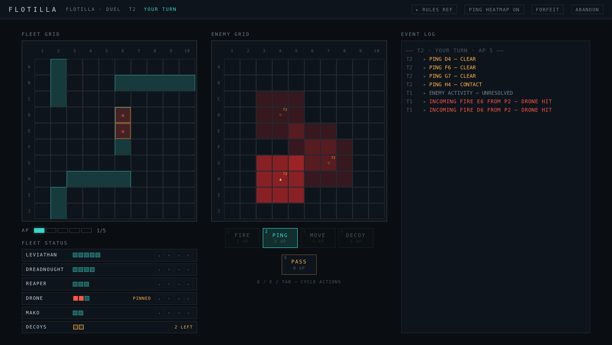
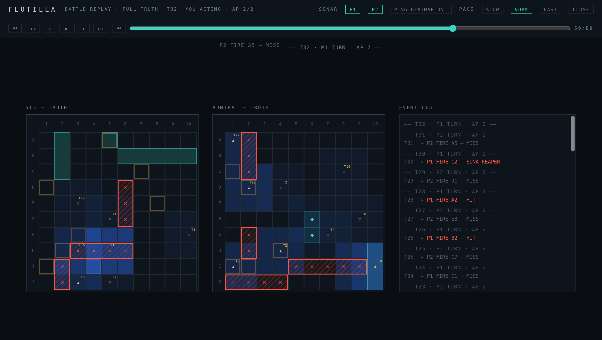
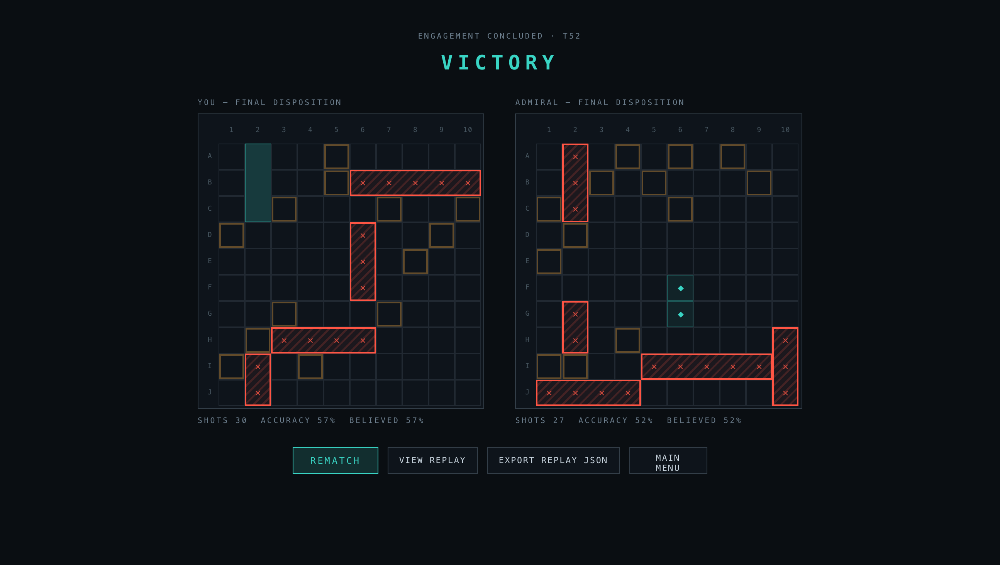
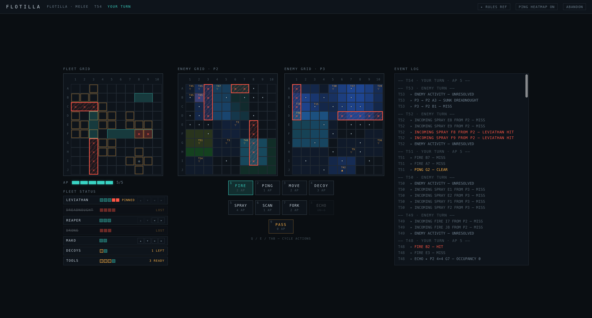

>*'All warfare is based on deception. Hence, when we are able to attack, we must seem unable; when using our forces, we must appear inactive; when we are near, we must make the  enemy believe we are far away; when far away, we must make him believe we are near.'*
>
> -- Sun Tzu

Battleship hides everything initially; you buy the truth one shot at a time. Stratego shows you where the enemy is but not what they are. Chess hides nothing, so the only fog of war is in your own mind.

The first of the three is the one that has kept pulling me back in like a maelstrom. I started playing games like these as a kid, and what stayed with me was how much complexity could emerge from a few simple rules in turn-based, adversarial play.

While working on reinforcement learning algorithms for competitive multiplayer games, I discovered [Kriegspiel](https://kriegsspiel.org/what-is-kriegsspiel/): chess played blind, where each player sees only their own pieces while a referee murmurs the consequences. [Dark chess](https://en.wikipedia.org/wiki/Dark_chess) variants descend from it, and learning about them explained why Battleship had always felt deeper than its reputation. Every shot is a hypothesis, every splash a verdict, and your model of the enemy is only ever a best guess.

  <figure>
    
    <figcaption>Black squares are fog. Only squares White’s pieces could legally move to are revealed.</figcaption>
  </figure>
  <figure>
    
    <figcaption>Shaded squares fall under White’s fog of war.</figcaption>
  </figure>

You start with zero information -- each contestant gets a loaded gun in a pitch-black room. The task: survive. So naturally, you act randomly. As the game unfolds, every hit and every miss forces you to build some representation of your beliefs about the fight, while the other player does the same.

<figure>
  
  <figcaption>The original game (Milton Bradley, 1967).</figcaption>
</figure>

But classic Battleship has a structural flaw that caps its uncertainty (and fun): the hidden state never changes, and your opponent can't respond to anything you do. Once your fleet is organized, the game is two interleaved solitaire puzzles. Optimal play is a probability heatmap over placements consistent with your evidence. So shoot the argmax, update, and repeat. The opponent's existence is almost irrelevant to your policy.

In this setup, your beliefs can be incomplete, but they can never become *wrong*. Nothing you believed on turn five is falsified by turn thirty. There’s no deception, because your opponent’s only lie is told before the first shot. I wanted the opposite: a game where yesterday’s hit can be today’s empty water, where the enemy keeps trying to deceive you after the first shots have been fired, and where knowing what you know costs something.

Thus, [FLOTILLA](https://dnl-strnl.github.io/flotilla/) was born: a Battleship variant where an attack is only true when it lands.

The skeleton is familiar: 10 × 10 board, five ships (renamed — Leviathan, Dreadnought, Reaper, Drone, Mako), sink all five to win. On top of that sits a deceptively simple action-point economy.

Each turn your AP budget equals your unsunk ship count, capped at 5 and floored at 2 — the old Salvo variant generalized into a tempo rule, so damage degrades how much you can do, but a surviving fleet can always afford at least one last stand. You spend the budget one micro-action at a time, seeing each result before choosing the next.

A `FIRE` costs 2 and gives you the classic hit/miss/sunk. A `PING` costs 1 and sweeps a 3 × 3 region for a single boolean: *"is anything there?"*, yes or no — and sonar only answers for *live* hulls, so wrecks and cells you've already hit ping clean. A `MOVE` costs 2 and slides one of your ships one cell in any of the four cardinal directions. A `DECOY` costs 3, max two per game, and this is where it gets mean. It plants a fake hull: shoot it and you're told `HIT`, and nothing tells you otherwise.

Sonar is drawn as a heatmap that fades from red to blue as readings go stale. The color shows how far you should still trust the sensors as information goes cold.

Movement is what makes beliefs falsifiable. Shot markers belong to *cells*, not ships — if a ship slides out from under your `MISS` marker, the stale marker stays, quietly lying to you. The counterweight is that a ship with any damage is pinned forever, so your first hit freezes something real; the game lets evidence decay but not dissolve.

Even motion isn't free, though: a moving ship leaves a wake — latent intel in the vacated water that the opponent has exactly one turn to dredge up with a `PING` before the sea smooths over. You must actively price the age and integrity of the information you receive whilst trying to corrupt your enemy's beliefs about where you are.

After the final kill, you can see a replay of what happened. Replays allow you to understand how your opponent behaved under uncertainty as the game evolved.

Step through both boards turn by turn and see what your opponent knew, and when. Watch long enough and the shape of their thinking begins to surface.

Things get even more interesting with a third fleet: `MELEE` mode.

Two fleets make a duel. Three make a hunt. Shoot at one rival and the other learns where you are; hold your fire and they both close in. Every shot you fire is seen by each rival, so every shell is a tell of where you're focused.

You still have `FIRE`, `PING`, `MOVE` and `DECOY`. Lose your first ship and the locker opens: four new tools for a fight that now has multiple fronts.

FLOTILLA is a toy by construction, but nothing inside it is: reconnaissance on a budget, resource allocation against an adversary who allocates back, and routing complex decisions made over beliefs instead of facts.

Trust nothing. Doubt everything. Fire at will.
