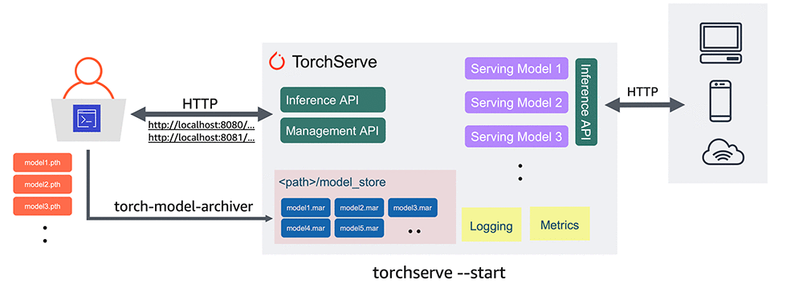
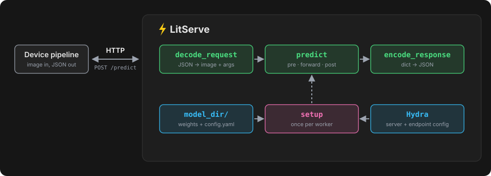

For four years I maintained the computer vision pipeline on an edge device for histopathology lab workflows. In that time, the model server behind it was rewritten exactly once.

From the outside, you couldn't tell. The pipeline still sent video frames to a model running on the same machine and got predictions back, exactly as it always had. Everything behind that exchange had gotten faster, easier to deploy, and far easier to change.

I went back through the git history to figure out the actual story of the changes. This is the condensed version for archaeological reference. 🕵️‍♂️

## 2022: TorchServe and the model archive file

[TorchServe](https://docs.pytorch.org/serve/) was the first real model server I worked with. Before that, "serving" PyTorch models meant an ad-hoc Flask application wrapped around a forward pass. That works for experiments or a demo and falls apart in three predictable places in production:

- **The model's lifecycle is the process's lifecycle.** The weights load when the app starts, once per worker, so four workers means four copies in GPU memory. Swapping a model means restarting the server. So scaling costs you memory you don’t have, and every model update is downtime.
- **Concurrency is your problem.** One request is one forward pass. Two requests at once either queue behind each other or fight over the GPU, and there's no batching unless you define it yourself.
- **Everything around the model is hand-rolled.** Health checks, timeouts, metrics, logging: each one is another route or decorator you wrote yourself, slightly differently in every project.

TorchServe closed that gap with very little effort on my part, because the answers were mostly already built in. A management API registered, scaled, and swapped models without restarting the server. Each model got its own pool of workers with optional dynamic batching. Health checks, metrics, and logging came with the server instead of with the project. And a lot of this was trivially configurable out of the box.

<figure>
  
  <figcaption>Diagram from the <a href="https://aws.amazon.com/blogs/machine-learning/deploying-pytorch-models-for-inference-at-scale-using-torchserve/">AWS Machine Learning Blog</a>.</figcaption>
</figure>

In this setup, a `handler.py` subclassing a `BaseHandler` defines how a request becomes a prediction. That process decomposes into essentially three phases: preprocessing, forward inference, and postprocessing.

In terms of implementation, I sought to design a minimal `BaseHandler` that would be agnostic to many underlying architectures for a given computer vision task. Models built for the same task share an output shape regardless of architecture (e.g. every detector returns boxes, scores, and labels), so one handler per task could cover all of them without duplicating the pre- and post-processing.

That constraint also paid off upstream: with the input and output format fixed per task, the data, the labels, and the model outputs all had to agree on it, and trying a new architecture with the same inputs and outputs meant swapping the weights instead of rebuilding everything around them.

In addition to the request handling logic, the endpoint needed the trained artifact itself: an optimized [TorchScript](https://docs.pytorch.org/TensorRT/ts/creating_torchscript_module_in_python.html) file holding the weights and the traced graph. The handy-dandy `torch-model-archiver` then zipped the necessary files into a `.mar` archive the server could load from its model store. Clients could then post raw image bytes to `localhost:8083/predictions/<model-name>` and get back predictions as a flat JSON list.

This worked well enough then, and it was the standard thing to do in 2022. But the archive format had a way of absorbing complexity. Every new ML task got its own handler module: classification, detection, segmentation, mask generation, speech recognition, and so on, each following the same pattern.

To compound the issue, there was more friction in the lifecycle management itself. A `.mar` is an archive you can't inspect from the outside, and any change to pre- or post-processing meant re-compressing, re-registering, and re-deploying the production artifact. Deploying on a device meant performing the same slow ritual by hand, every single time.

## 2025: Enter LitServe ⚡

In July 2025, I replaced the handlers, the archiver, and the model store with fewer than 100 lines, built on [LitServe](https://github.com/Lightning-AI/LitServe) and configured with [Hydra](https://hydra.cc/). Hydra was already how training was configured, through hierarchical configs, and the device pipeline that called the server used it too, so the new server made it one config system from training to serving to the code consuming the predictions. LitServe is the serving layer built by [Lightning AI](https://github.com/lightning-ai) on top of [FastAPI](https://github.com/fastapi/fastapi). You subclass `LitAPI`, implement four methods, and hand it to `LitServer`:

```python
class Inference(litserve.LitAPI):
    def setup(self, device):
      # load once per worker
    def decode_request(self, request):
      # JSON -> PIL image + inference args
    def predict(self, inputs):
      # preprocess, forward, postprocess
    def encode_response(self, output):
      # dict -> JSON
```

That shape is the entire reason the migration was cheap. The TorchServe handler already had the same three phases; they just had different names and a context object threaded through them.

Moving the logic over was mostly deleting the `.mar` plumbing, which felt refreshing from a code hygiene standpoint. A few things fell out of the change that I didn't plan for:

- **Hydra owned the server config.** The server, the endpoint class, and the input directory were all instantiated from a YAML file, so a new task was a new config and a new `Inference` subclass. Nothing else.
- **The trained model directory was the deployable unit.** A folder with a weights file and the `config.yaml` that training wrote. No archive step. The server read class names, image format, and default inference arguments straight from the training config, so the handler couldn't drift from the model it was trained with.
- **Per-request arguments with config defaults.** Confidence thresholds, IoU, and other arguments: each one had a default in the model's config and could be overridden in the request body. Under TorchServe the defaults lived in the handler, sealed inside the archive.



The client-side diff when the device pipeline switched over, a month later, was three URL changes and one `.get('predictions', {})`. The request body didn't change at all: the handlers had long since moved from raw bytes to JSON with a base64-encoded image. The TorchServe handler files were eventually deprecated and deleted from the repo. TorchServe itself was marked [limited maintenance](https://docs.pytorch.org/serve/README.html), with no further updates or security patches, and the [repository](https://github.com/pytorch/serve) was archived on August 7th, 2025, three weeks after the first LitServe commit landed. In hindsight, that makes the move feel less like a preference and more like a well-timed dodge. ⚰️

## 2026: ONNX Runtime and TensorRT

The next important change was to the model architecture, not the serving layer. In April 2026, I began to promote candidates of [RF-DETR](https://rfdetr.roboflow.com/), Roboflow's real-time detection transformer, into production. RF-DETR ships a clean ONNX export, and that was the excuse to teach the server a second backend.

From then on, the server picked its backend from the file extension in the model directory. A `.ts` (TorchScript) or `.pt` went through `torch.jit.load` as before. A `.onnx` opened an [ONNX Runtime](https://onnxruntime.ai/) session with an execution provider list ordered TensorRT, then CUDA, then CPU:

```python
providers = [
    ("TensorrtExecutionProvider", {
        "trt_fp16_enable": True,
        "trt_engine_cache_enable": True,
        "trt_engine_cache_path": str(model_dir / "trt_cache"),
    }),
    "CUDAExecutionProvider",
    "CPUExecutionProvider",
]
```

The [TensorRT execution provider](https://onnxruntime.ai/docs/execution-providers/TensorRT-ExecutionProvider.html) compiles the graph into an engine for the specific card it's running on, in `fp16`, and caches it beside the model so the compile cost is paid once per device instead of once per restart. Without the cache, every restart would rebuild the engine, a cold start measured in minutes instead of seconds.

Same `/predict` endpoint, same JSON, same client. The device didn't know the model's forward pass had changed runtimes.

One gotcha worth writing down: `get_available_providers()` reports what the wheel was built with, not what the host can use. A GPU build happily offers CUDA on a box with no visible device and then fails to initialize the session. The fix was to gate provider selection on an actual `torch.cuda.is_available()` check, and to downgrade `self.device` to CPU if ONNX Runtime quietly fell back, so preprocessing didn't shuttle tensors to a GPU the session wasn't using.

With the backend now able to vary by host, and to fall back without failing, I wanted the server to report exactly what it was doing. Every prediction came to carry its own provenance: the hostname, the device, the backend, the model file name, the GPU, and two timings. One was wall-clock for the whole request. The other was the model forward pass alone, measured precisely between two `torch.cuda.synchronize()` calls so it reflected compute instead of queue submission (a latency number without the hardware that produced it isn't a very useful measurement).

## The build vs. bake dilemma

There's a long-running argument about whether model weights belong inside the serving image or beside it. I kept them beside it: one image served every model, and deployment on the device reduced to one manifest. Each entry was a role, an S3 artifact location, a checksum, and a target port number for on-device serving.

The device installer downloaded what was listed and generated a Docker Compose service per model, so nothing was fetched when a container started. Adding or replacing a model truly became a one-file change.

Notably, TensorRT settled part of the argument on its own. The compiled engine is specific to the GPU that built it, so it can't ship in an image, and it needs a writable directory to live in.

## Takeaways

Across about a hundred commits, the request path never changed. The `decode_request` / `predict` / `encode_response` pattern from the first LitServe commit is still there as written. What grew around it is everything the TorchServe version never did: choosing between runtimes at startup, checking which hardware accelerators are actually usable, and reporting where each prediction came from and how long it took.

In the end, most of what I changed was in model initialization, and nearly all of it was about hardware: which runtime, which GPU, and how to monitor them across different compute environments. The server knows more about the machine every year and less about the model, and that's why I could swap the model, the runtime, and the framework without the client noticing.

That setup has run live inference on millions of video frames per month and efficiently processed thousands of hours of lab video streams, and it is still one file that a new engineer can read in an afternoon and change the same day.
