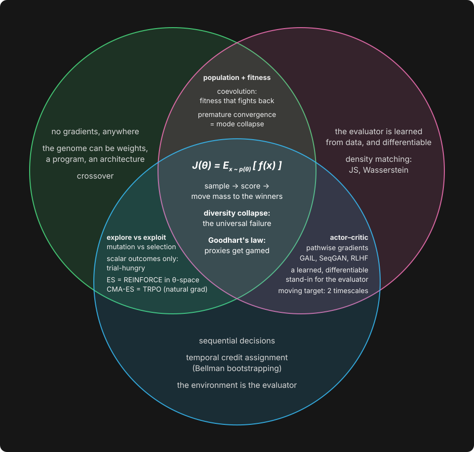

I have never been as interested in any one idea in AI as in what ties them together.

In 2019, I jotted down a realization that I had as three overlapping circles: EAs, GANs, and RL, and over a few discussions with my coworkers, I filled in the overlaps as a way to understand the nuances of each subfield:

- EAs and RL share the exploration/exploitation trade-off, genetic mutation on one side and policy entropy on the other.
- EAs and GANs share a population being scored by a fitness function.
- GANs and RL both train against a critic they built themselves.

One day, the whiteboard with all of this got erased, and I tried to keep the shape of it in my head without all of the details worked out exactly...

This post is an attempted reconstruction, with the parts I didn't have time for then: the actual equations the three fields share, and which pairs share them.

<figure>
  
  <figcaption>The diagram, redrawn. Pairwise overlaps are where the fields borrowed from each other; the center is what they all share.</figcaption>
</figure>

Evolution, GANs, and RL sound like they come from different planets: one borrows from biology, one from game theory, one from animal training. Write down what each one actually computes, though, and the mathematical formalizations line up far more than the names suggest. The mismatches turned out to be the more interesting part. Each field is a different set of answers to the same few design questions, and comparing the three is the best way I know to separate principles of learning from habits of one field.

## At the heart of it all

Squint long enough at the Venn diagram and patterns start to emerge. There is a distribution over candidate solutions that the learner controls. Draw from it, score the draws, and move the distribution toward the draws that scored well. The objective, written once:

$$
J(\theta) = \mathbb{E}_{x \sim p_\theta}\left[ f(x) \right]
$$

Here $$J$$ is the objective, the single number the learner is trying to push up. $$\theta$$ are the learned parameters, the only thing the learner gets to change. $$p_\theta$$ is the distribution over candidate solutions that those parameters define, and $$x \sim p_\theta$$ is one candidate drawn from it. $$f(x)$$ is the score the evaluator gives that candidate, and $$\mathbb{E}$$ is the expectation, the average of that score over every draw the distribution could produce. So $$J(\theta)$$ reads: how well do the candidates score, on average, at the current setting of the parameters?

What changes between the fields is what the three key symbols mean:

| | the distribution $$p_\theta$$ | a draw $$x$$ | the score $$f$$ |
|---|---|---|---|
| Evolutionary algorithm | the population (or, in evolution strategies, a Gaussian over genomes) | a genome | fitness |
| Reinforcement learning | the policy, and the trajectory distribution it induces | a trajectory | return |
| GAN | the generator | a fabricated data sample | the discriminator's authenticity score |

Sample, score, shift. In evolutionary terms, this is called selection and reproduction. In RL it's called policy improvement. In a GAN, it's the generator step.

The question that splits the diagram into its regions is: *how* do you shift the distribution? $$\theta$$ never reaches $$f$$; the evaluator scores whatever it's handed. All $$\theta$$ controls is which $$x$$ come out. That leaves two ways to get a gradient:

- Change how likely each draw is.
- Hold the noise fixed and slide each draw toward a higher score, which means asking the evaluator which way is uphill.

The first, the **score-function** estimator, never looks inside $$f$$:

$$
\nabla_\theta J = \int f(x)\, \nabla_\theta p_\theta(x)\, dx = \mathbb{E}_{x \sim p_\theta}\left[ f(x)\, \nabla_\theta \log p_\theta(x) \right]
$$

$$f$$ doesn't depend on $$\theta$$, so the gradient passes straight through it to $$p_\theta$$. That leaves an integral, which you can't compute by sampling. Rewriting $$\nabla p$$ as $$p\,\nabla \log p$$ puts a $$p_\theta(x)$$ back in front, so the integral turns back into an average over draws. Read it term by term. $$\nabla_\theta \log p_\theta(x)$$ is the direction in parameter space that makes this particular $$x$$ more likely. $$f(x)$$ is just a number saying how hard to push that way. For every draw, nudge the parameters toward producing it again, harder the better it scored. The direction comes entirely from the distribution, and $$f$$ is never differentiated, which is why the evaluator can be anything you can call.

One practical detail matters later. You can subtract the average score from every draw's score without changing the gradient on average, because making some draws more likely necessarily makes others less likely. It makes each estimate far less noisy, though, since every draw now pushes only by how much better or worse than average it did. That's the `adv` (advantage) line in the code below, and the baseline in every policy-gradient method.

Now plug in the RL row of the table. A trajectory's probability is a product of the policy's choices and the environment's dynamics; the logarithm turns that product into a sum, and only the policy terms depend on $$\theta$$, so the dynamics drop out. With the return $$R(\tau)$$ as the score:

$$
\nabla_\theta J = \mathbb{E}_{\tau}\left[ R(\tau) \sum_t \nabla_\theta \log \pi_\theta(a_t \mid s_t) \right]
$$

That is [REINFORCE](https://doi.org/10.1007/BF00992696), and the vanished dynamics are why policy gradients need no model of the world.

The other way to get a gradient, sliding each draw instead of changing how likely it is, is the **pathwise** estimator. Write the draw as a deterministic function of noise, $$x = g_\theta(z)$$, so that moving $$\theta$$ moves $$x$$ itself, and differentiate *through the score*:

$$
\nabla_\theta J = \mathbb{E}_{z}\left[ \nabla_x f(x)\big|_{x = g_\theta(z)}\; \nabla_\theta g_\theta(z) \right]
$$

That is how a GAN trains its generator. It has far lower variance, and it is only available if you are allowed to call $$\nabla_x f$$. Whether you are allowed to differentiate through the evaluator is the single most important fact about any algorithm in this diagram. Evolution and RL say no: the evaluator is a simulator, a game, a physical robot, the world. GANs say yes, because they built the evaluator themselves out of a neural network. Actor–critic is RL changing its answer from no to yes, and that is why it sits in the overlap with GANs rather than anywhere else.

Here is the score-function loop in code, written so that it is not obviously evolution or RL:

```python
import numpy as np
rng = np.random.default_rng(0)

def f(x): # the evaluator: a black box we can only call...
    return -np.sum((x - 3.0) ** 2, axis=-1)

def sample_score_shift(theta, sigma=0.1, n=64, lr=0.05, steps=200):
    for _ in range(steps):
        eps = rng.standard_normal((n, theta.size))                # sample
        scores = f(theta + sigma * eps)                           # score
        adv = (scores - scores.mean()) / (scores.std() + 1e-8)    # baseline
        theta = theta + lr * (adv[:, None] * eps).mean(0) / sigma # shift
    return theta
```

Rename `theta` to the mean of a Gaussian policy, `f` to the reward, and `adv` to the advantage, and this is REINFORCE on a continuous bandit, baseline included. Rename `eps` to mutation, `n` to the population size, and the weighted mean to recombination, and it is an evolution strategy.

## Evolution and RL: one estimator, two places to put the noise

The cleanest statement of the evolution–RL overlap is [Salimans et al. (2017)](https://arxiv.org/abs/1703.03864), which got evolution strategies running on [MuJoCo](https://mujoco.org) and Atari at scale and said the quiet part out loud: for a Gaussian search distribution centered at $$\theta$$ with scale $$\sigma$$,

$$
\nabla_\theta\, \mathbb{E}_{\epsilon \sim \mathcal{N}(0, I)}\left[ f(\theta + \sigma\epsilon) \right] = \frac{1}{\sigma}\, \mathbb{E}_{\epsilon}\left[ f(\theta + \sigma\epsilon)\, \epsilon \right]
$$

which is the score-function identity with $$p_\theta = \mathcal{N}(\theta, \sigma^2 I)$$ plugged in. It says that the "gradient-free" ES update is the exact gradient of a Gaussian-smoothed version of $$f$$.

The equation looks scarier than it is. The left side is the slope of the average score around $$\theta$$. The right side says how to get it: jiggle $$\theta$$ in random directions $$\epsilon$$, score each jiggled copy, and average the directions weighted by their scores, so the ones that scored well pull $$\theta$$ toward them. That is the `shift` line in the code above, minus the baseline. There is nothing gradient-free about it; the gradient just comes from sampling instead of backpropagation.

REINFORCE with a Gaussian policy produces the identical expression. The difference is where the noise goes: ES perturbs the *parameters* once per episode, RL perturbs the *actions* at every step. [Plappert et al.](https://arxiv.org/abs/1706.01905) closed that gap from the RL side by injecting parameter-space noise into [DQN](https://doi.org/10.1038/nature14236) and [DDPG](https://arxiv.org/abs/1509.02971), and [Such et al.](https://arxiv.org/abs/1712.06567) closed it from the other side by training 4-million-parameter Atari policies with a plain genetic algorithm.

That estimator comes with a shared cost: it only learns how good each draw was, never which way to move, so its variance grows with the number of parameters in ES and with the length of the episode in RL, and both fields are notoriously trial-hungry.

**Exploration and exploitation have the same dial.** Mutation rate is $$\sigma$$, and $$\sigma$$ is policy entropy. Selection pressure is greediness. The deeper rhyme is in the failure modes. Evolutionary computation calls a landscape *deceptive* when fitness points away from the optimum; RL calls the same thing a sparse or misleading reward. The evolutionary answer, [novelty search](https://doi.org/10.1162/EVCO_a_00025) (Lehman & Stanley 2011), which throws out the objective and rewards behaving differently from the archive, is intrinsic motivation and [curiosity](https://arxiv.org/abs/1705.05363) with the serial numbers filed off. [Go-Explore](https://arxiv.org/abs/1901.10995), which cracked [Montezuma's Revenge](https://en.wikipedia.org/wiki/Montezuma%27s_Revenge_%28video_game%29) by keeping an archive of cells and returning to promising ones before exploring, is [MAP-Elites](https://arxiv.org/abs/1504.04909) applied to RL, and its authors came from the evolution side and said so.

## GANs and RL: when the critic is a network

The GAN–RL overlap has a canonical paper, [Pfau & Vinyals (2016)](https://arxiv.org/abs/1610.01945). Write the generator's gradient and the deterministic actor's gradient from DDPG next to each other:

$$
\nabla_\theta\, \mathbb{E}_{z}\left[ \log D_w\big(G_\theta(z)\big) \right]
\qquad\text{vs.}\qquad
\nabla_\theta\, \mathbb{E}_{s}\left[ Q_w\big(s, \mu_\theta(s)\big) \right]
$$

Same shape. On each side, a generator with parameters $$\theta$$ produces something (the GAN's $$G_\theta$$ makes a sample; DDPG's policy $$\mu_\theta$$ picks an action for state $$s$$), a critic with its own parameters $$w$$ scores it ($$D_w$$ or $$Q_w$$), and the generator trains on the pathwise gradient through the critic. [WGAN](https://arxiv.org/abs/1701.07875) dropped the pretense and just called the discriminator a critic.

The only structural difference is what trains the critic. The discriminator learns to tell real samples from generated ones, and its labels come from outside: real data is labeled positive, the generator's output negative. The Q-function learns from the [Bellman residual](https://doi.org/10.1016/B978-1-55860-377-6.50013-X): its target is the reward $$r$$ it just got plus its own estimate of what comes next, $$r + \gamma\, Q_w\big(s', \mu_\theta(s')\big)$$, where $$s'$$ is the next state and $$\gamma < 1$$ discounts the future. That target contains its own prediction, so the Q-function is partly regressing on itself.

The two fields have independently discovered the same pathologies and the same patches:

| GAN trick | RL trick | the shared problem |
|---|---|---|
| two-timescale updates ([TTUR](https://arxiv.org/abs/1706.08500)), several D steps per G step | target networks, slow critic updates | the critic is a moving target and the actor chases it |
| replay old generated samples ([SimGAN](https://arxiv.org/abs/1612.07828)) | experience replay | the critic forgets what the generator used to do |
| generator finds D's blind spots | reward hacking, over-optimizing a learned reward | the critic is a proxy, and pressure finds the gap |

Then there are the algorithms that sit *exactly* on the boundary, where one field's method collapses into the other's. [SeqGAN](https://arxiv.org/abs/1609.05473) wanted a GAN over discrete tokens, discovered that you can't backprop through an argmax, and trained the generator with REINFORCE using the discriminator's output as the reward. The moment the pathwise gradient became unavailable, the GAN became an RL problem. [GAIL](https://arxiv.org/abs/1606.03476) went the other way: imitation learning as a GAN, with a discriminator between expert and policy trajectories serving as the reward.

## GANs and evolution: fitness that fights back

The GAN–evolution overlap is the one that got me started on the whiteboard, and it is the one I had most wrong. The surface correspondence is clear: a generator produces a population of samples, and the discriminator is a fitness function. But a fitness function in a classical GA is fixed, and the discriminator is not. It is trained *against* the generator, on the generator's own output. The evolutionary computation literature has a name for an evaluator that adapts to the population it evaluates: [competitive coevolution](https://doi.org/10.1162/evco.1997.5.1.1). And it has a founding example that predates GANs by twenty-four years. [Hillis (1990)](https://doi.org/10.1016/0167-2789(90)90076-2) evolved sorting networks against a coevolving population of "parasites," test cases rewarded for breaking the sorters. The sorters evolved to beat the tests, the tests evolved to find what the sorters got wrong, and the result was better than evolving against a fixed test suite. That is essentially a GAN setup with the gradients removed.

Once you see it as coevolution, every GAN pathology has a thirty-year-old name:

| coevolution | GAN |
|---|---|
| disengagement, loss of gradient: one population dominates and the other gets no useful signal | the discriminator saturates and the generator's gradient vanishes ([Goodfellow's non-saturating loss](https://arxiv.org/abs/1406.2661) is the patch) |
| cycling, the [Red Queen effect](https://en.wikipedia.org/wiki/Red_Queen_hypothesis) | oscillation and [non-convergence](https://arxiv.org/abs/1801.04406) of the minimax game |
| forgetting: the population loses the ability to beat opponents it already beat | [catastrophic forgetting in the discriminator](https://arxiv.org/abs/1807.04015) |
| premature convergence, loss of diversity | mode collapse |
| fitness sharing, niching | [minibatch discrimination](https://arxiv.org/abs/1606.03498), [PacGAN](https://arxiv.org/abs/1712.04086) |
| the [hall of fame](https://doi.org/10.1162/evco.1997.5.1.1) (Rosin & Belew 1997) | historical averaging, keeping old discriminators, [AlphaStar's league](https://doi.org/10.1038/s41586-019-1724-z) |

The minimax objective $$\min_G \max_D V(D, G)$$ is a two-population coevolutionary game. The borrowing has since gone both ways: [E-GAN](https://arxiv.org/abs/1803.00657) and [Lipizzaner](https://arxiv.org/abs/1811.12843) train a *population* of generators with mutation and selection against the discriminator, and self-play RL from [AlphaGo](https://doi.org/10.1038/nature16961) onward is coevolution with a gradient.

## What each field keeps for itself

The regions outside the overlaps are surprisingly small, but they are the reason the fields haven't merged.

**Evolution** has no gradients anywhere, and so it can search spaces where nothing is differentiable: architectures ([AmoebaNet](https://arxiv.org/abs/1802.01548)), programs ([AutoML-Zero](https://arxiv.org/abs/2003.03384), which evolved learning algorithms from scratch out of basic math ops), and reward functions themselves. It also has crossover, which has no clean analog in the other two fields, though model merging and weight-space averaging rhyme with it.

**RL** has time. The Bellman equation, bootstrapping, the [deadly triad](https://arxiv.org/abs/1812.02648), and the whole problem of a consequence that arrives two hundred steps after the decision that caused it belong to RL alone. Neither evolution nor GANs have a notion of credit that has to travel backward through a sequence.

**GANs** have an evaluator that is learned from data, and an objective that is a divergence between densities. In a GAN, the discriminator is a learned proxy for a distribution you can only sample from, which is simultaneously the GAN's superpower and the reason it is always one step from being fooled.

## Goodhart's law and the three-circle overlap

Three things live where all three circles overlap. The first is the loop. The second is diversity collapse, the same lesson, three times: premature convergence, policy entropy going to zero, mode collapse. The third is the one I think is the real meta-thread.

[Lehman et al. (2018)](https://arxiv.org/abs/1803.03453) collected anecdotes from decades of digital evolution: creatures that evolved to exploit floating-point bugs in the physics engine, a program that "fixed" a sorting bug by deleting the output, an agent that discovered it could get fitness by crashing the simulator. The RL literature has a parallel catalog of reward hacking: the player that spins in circles collecting the same reward token forever, the robot that learned to hold the block in front of the camera instead of grasping it. The GAN literature doesn't usually frame it this way, but the generator's entire job is to find adversarial examples for the discriminator, and it does. And [Gao et al. (2022)](https://arxiv.org/abs/2210.10760) measured, for RLHF, the point past which optimizing against a learned reward model makes the true objective *worse*.

This is Goodhart's law, discovered independently three times. Whenever the evaluator is a proxy, and it always is, optimization pressure finds the gap between the proxy and the thing you meant. Each field also found the same three patches:

- **Limit how far you move per step:** trust regions, KL penalties, step-size control.
- **Regularize the proxy:** gradient penalties, reward model ensembles.
- **Keep the proxy moving so it can't be exploited for long:** retrain the discriminator, retrain the reward model, coevolve the test cases.

Hillis's parasites in 1990 were the first "keep the proxy moving" fix, and they're still the clearest one.

## The 2×2 I should have drawn instead

Reconstructing the Venn diagram convinced me that it is right and that it is the wrong shape. The three fields are not three things. They are the corners of two questions about the evaluator:

| | the evaluator is fixed | the evaluator adapts to you |
|---|---|---|
| **you can't differentiate through it** | genetic algorithms, evolution strategies, REINFORCE, cross-entropy method | coevolution, self-play, SeqGAN |
| **you can differentiate through it** | supervised learning | GANs, actor–critic, GAIL |

Supervised learning falls out as the boring corner: a fixed, differentiable evaluator is just a loss function, and you don't need any of this. Everything else in the diagram is some mixture of "I can't differentiate the thing I care about" and "the thing I care about moves when I move." Actor–critic and the discriminator are both ways of buying your way from the top row into the bottom one.

## What every field learned the hard way

Reading the three fields against each other leaves a short list of things that seem to hold no matter which one you're in:

- **Differentiate through the evaluator if you can.** The pathwise gradient is far less noisy. If you can't, sampling still gets you a real gradient, just a noisier one.
- **Score draws against each other, not in absolute terms.** ES and RL both got there separately: fitness shaping on one side, advantages on the other.
- **Protect diversity.** Premature convergence, entropy collapse, and mode collapse are the same failure, and each field had to build something to fight it: fitness sharing, entropy regularization, minibatch discrimination.
- **Assume the evaluator will be exploited.** Take small steps, regularize it, or keep it moving.
- **A learned critic is a trade.** It buys you a gradient and costs you a target that moves, sometimes because it's chasing itself.

## After 2019

I drew the diagram the year before language models ate the field, and the funny thing is that the LLM era has mostly been a re-run of it. The three that make the case best:

- [Shao et al. (2024)](https://arxiv.org/abs/2402.03300) introduced GRPO, the algorithm behind [DeepSeek-R1](https://arxiv.org/abs/2501.12948): sample a group of outputs, normalize each reward by the group's mean and standard deviation, no value network. That is the `adv` line in the code block above, and it is an ES-style population baseline inside a policy-gradient method.
- [Rafailov et al. (2023)](https://arxiv.org/abs/2305.18290), DPO, "your language model is secretly a reward model," folds the critic into the actor.
- [Qiu et al. (2025)](https://arxiv.org/abs/2509.24372) scaled plain evolution strategies to full-parameter LLM fine-tuning and reported less reward hacking than RL.
